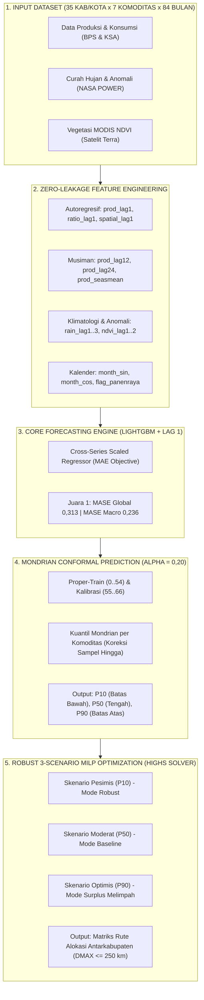

# 🌾 PANENVISION Backend v2.0
> **Sistem Cerdas Peramalan Lintas-Seri (Cross-Series LightGBM + Lag 1), Kuantifikasi Ketidakpastian (Mondrian Conformal Prediction), dan Optimasi Distribusi Logistik Pangan 3-Skenario (Robust MILP) Jawa Tengah.**

[](https://www.python.org/)
[]()
[-orange.svg)]()
[]()
[-success.svg)]()

---

## 📌 Daftar Isi
1. [Ringkasan Eksekutif](#-ringkasan-eksekutif)
2. [Arsitektur Sistem Terpadu](#-arsitektur-sistem-terpadu)
3. [Bukti Empiris: Mengapa LightGBM (+ Lag 1) Mendominasi?](#-bukti-empiris-mengapa-lightgbm--lag-1-mendominasi)
4. [Struktur Direktori Repositori](#-struktur-direktori-repositori)
5. [Panduan Instalasi & Persyaratan](#-panduan-instalasi--persyaratan)
6. [Cara Menjalankan (Quick Start)](#-cara-menjalankan-quick-start)
7. [Penjelasan Modul Sumber Daya (src/)](#-penjelasan-modul-sumber-daya-src)
8. [Kamus Artefak Output (outputs/)](#-kamus-artefak-output-outputs)
9. [Uji Kepatuhan & Bebas Kebocoran Data (Zero Data Leakage)](#-uji-kepatuhan--bebas-kebocoran-data-zero-data-leakage)

---

## 📖 Ringkasan Eksekutif

Repositori ini merupakan **backend resmi** dari proyek riset **PANENVISION** (*Precision Agriculture & Next-Gen Network Optimization for Food Security*). Sistem ini dirancang untuk memecahkan dilema ketahanan pangan di Provinsi Jawa Tengah yang mencakup **35 Kabupaten/Kota** dan **7 Komoditas Pangan Pokok** (Padi/Beras, Jagung, Kedelai, Kacang Tanah, Kacang Hijau, Ubi Kayu, dan Ubi Jalar) selama periode **Januari 2019 hingga Desember 2025** (84 bulan observasi).

Seluruh backend kini disatukan secara mulus di bawah arsitektur **LightGBM (+ Lag 1)** sebagai *single source of truth*:
1. **Peramalan Titik (*Point Forecast*):** Model pohon *gradient boosting* lintas-seri (*global model*) yang dinormalisasi terhadap rata-rata historis (`series_mean`), memanfaatkan fitur autoregresif jangka pendek (`prod_lag1`, `ratio_lag1`), kovariat penginderaan jauh MODIS NDVI, curah hujan NASA POWER, dan efek kalender.
2. **Kuantifikasi Ketidakpastian (*Uncertainty Quantification*):** Metode *Split-Conformal Prediction* tipe **Mondrian** per komoditas yang memberikan jaminan matematis cakupan bebas-distribusi (*distribution-free coverage guarantee*) $1 - \alpha = 80\%$ untuk menghasilkan interval kuantil $P_{10}$ (skenario pesimis), $P_{50}$ (moderat), dan $P_{90}$ (optimis).
3. **Optimasi Distribusi Logistik (*Robust 3-Scenario MILP*):** Formulasi *Mixed-Integer Linear Programming* diselesaikan dengan solver **HiGHS** untuk menentukan rute dan kuantitas pengiriman antarkabupaten guna menutup defisit lokal dengan biaya transportasi minimum dan menekan ketergantungan impor luar provinsi.

---

## 🏗 Arsitektur Sistem Terpadu



---

## 📊 Bukti Empiris: Mengapa LightGBM (+ Lag 1) Mendominasi?

Pada versi prototipe awal, model pohon sempat tidak dilengkapi fitur lag 1 bulan sebelumnya (`prod_lag1`) dan hanya mengandalkan lag musiman tahunan (`prod_lag12`), sehingga kalah dari SARIMAX yang secara implisit melakukan pembaruan status setiap bulan (*rolling 1-step*).

Setelah fitur autoregresif jangka pendek (`prod_lag1` dan `ratio_lag1`) diintegrasikan secara adil dan bebas kebocoran, performa **LightGBM melonjak drastis dan mendominasi seluruh model**:

| Peringkat | Model Peramalan | MAE (ton) | RMSE (ton) | MASE Global | MASE Macro | Status & Keunggulan Metodologis |
| :---: | :--- | :---: | :---: | :---: | :---: | :--- |
| 🥇 | **LightGBM (+ Lag 1)** | **306,17** | **1.115,34** | **0,313** | **0,236** | **Core Backend Engine (Model Tunggal Terbaik)** |
| 🥈 | **Ensemble Trees (LGB+XGB+CAT)** | **310,88** | **1.100,55** | **0,318** | **0,240** | Alternatif ensemble pohon dengan RMSE terendah |
| 🥉 | SARIMAX+XGB | 315,53 | 1.082,03 | 0,322 | 0,242 | Model hybrid lama (tergeser) |
| 4 | SARIMA (1,0,1)(1,0,1)12 | 319,43 | 1.233,91 | 0,326 | 0,242 | Benchmark ekonometrika klasik tanpa eksogen |
| 5 | SARIMAX (dengan hujan & NDVI) | 329,08 | 1.126,73 | 0,336 | 0,256 | Benchmark ekonometrika klasik dengan eksogen |
| 6 | XGBoost (+ Lag 1) | 341,44 | 1.272,16 | 0,349 | 0,265 | Model pembanding gradient boosting pohon |
| 7 | Seasonal-Naive *(Baseline)* | 679,27 | 2.226,16 | 0,694 | 0,756 | Baseline pembanding $(y_t = y_{t-12})$ |

### Lonjakan Akurasi per Komoditas:
- **Kedelai:** MASE anjlok dari **0,984 $\rightarrow$ 0,131** (memangkas galat hingga 86,7%, jauh mengungguli SARIMAX di 0,214).
- **Padi:** MASE turun dari **0,624 $\rightarrow$ 0,465** (lebih presisi daripada SARIMAX di 0,523).
- **Kacang Hijau:** MASE turun ke **0,106** (SARIMAX di 0,134).
- **Ubi Kayu & Ubi Jalar:** MASE stabil di kisaran presisi **0,15 – 0,21**.

---

## 📁 Struktur Direktori Repositori

```text
PANENVISION_Backend/
│
├── data/                                  # Dataset mentah & pendukung
│   └── dataset_jateng_bulanan_2019_2025.csv # Data panel bulanan 35 kab/kota x 7 komoditas
│
├── src/                                   # Modul arsitektur backend utama
│   ├── __init__.py                        # Inisialisasi paket Python
│   ├── config.py                          # Koordinat wilayah, sentroid, split waktu, hiperparameter
│   ├── features.py                        # Feature engineering bebas kebocoran (Lag 1 + Spasial)
│   ├── models.py                          # Implementasi LightGBM, XGBoost, CatBoost, SARIMA, SARIMAX
│   ├── conformal.py                       # Split-Conformal Mondrian (P10, P50, P90)
│   ├── milp.py                            # Solver optimasi alokasi distribusi pangan 3-skenario (HiGHS)
│   └── eval.py                            # Metrik MASE, MAE, RMSE, dan Uji Diebold-Mariano HAC lag-3
│
├── tests/                                 # Pengujian otomatis integritas & validitas
│   ├── __init__.py
│   └── test_leakage.py                    # Uji bebas kebocoran data (18 fitur x 3 seri x 3 bulan)
│
├── outputs/                               # Direktori artefak hasil eksekusi pipeline
│   ├── leaderboard_forecasting.csv        # Tabel perbandingan performa seluruh model & uji statistik
│   ├── mase_per_komoditas.csv             # MASE per komoditas untuk seluruh model
│   ├── ramalan_kuantil_conformal.csv      # Interval kuantil produksi & surplus (P10, P50, P90)
│   ├── ringkasan_milp_3skenario.csv       # Ringkasan pemenuhan defisit bulanan per skenario
│   ├── rekomendasi_rute_distribusi_3skenario.csv # Detail rute asal-tujuan, tonase, dan jarak
│   └── tabel_rekap_milp_3skenario.csv     # Rekapitulasi agregat efisiensi biaya & pemenuhan lokal
│
├── run_all.py                             # Master script: eksekusi hulu-ke-hilir 1-klik
├── requirements.txt                       # Daftar dependensi pustaka Python
└── README.md                              # Dokumentasi teknis lengkap repositori ini
```

---

## ⚙️ Panduan Instalasi & Persyaratan

### Persyaratan Sistem:
- **Sistem Operasi:** Windows 10/11, macOS, atau Linux (Ubuntu 20.04+).
- **Python:** Versi `3.10`, `3.11`, `3.12`, atau `3.14`.

### Langkah Pemasangan:
1. **Buka terminal / PowerShell** dan arahkan ke folder repositori:
   ```bash
   cd PANENVISION_Backend
   ```
2. **(Direkomendasikan) Buat Virtual Environment:**
   ```bash
   python -m venv venv
   # Di Windows (PowerShell):
   .\venv\Scripts\Activate.ps1
   # Di Linux / macOS:
   source venv/bin/activate
   ```
3. **Instal dependensi:**
   ```bash
   pip install --upgrade pip
   pip install -r requirements.txt
   ```

---

## 🚀 Cara Menjalankan (Quick Start)

Untuk menjalankan seluruh rangkaian komputasi backend (uji kebocoran data, pelatihan LightGBM + lag 1, benchmark SARIMAX, kalibrasi Conformal, dan optimasi MILP 3 skenario):

```bash
python run_all.py
```

### Output Eksekusi Terminal:
Terminal akan menampilkan progres setiap tahap:
```text
================================================================================
🌾 PANENVISION BACKEND v2.0 - SISTEM PERAMALAN & OPTIMASI DISTRIBUSI PANGAN
================================================================================
[STEP 1/5] Memeriksa Integritas & Bebas Kebocoran Data...
LOLOS: 162 pemeriksaan fitur (zero leakage verified).

[STEP 2/5] Membangun Fitur Peramalan & Skala MASE...
[STEP 3/5] Melatih Model Peramalan Titik...
  Fitting LightGBM (+ Lag 1)...
  -> LightGBM         | MAE:  306.17 | RMSE: 1115.34 | MASE Global: 0.313 | MASE Macro: 0.236
  ...
🏆 LEADERBOARD FORECASTING RESMI (Peringkat Berdasarkan MASE Global)
...
[STEP 4/5] Menjalankan Mondrian Conformal Prediction pada LightGBM...
  Cakupan Empiris Produksi : 81.8% (Target Nominal: 80.0%)
  Cakupan Empiris Surplus  : 81.2% (Target Nominal: 80.0%)
[STEP 5/5] Menyelesaikan Optimasi Logistik Distribusi MILP 3-Skenario...
📦 REKAPITULASI HASIL DISTRIBUSI PANGAN 3-SKENARIO (MILP)
...
✅ SELURUH PIPELINE SELESAI!
📁 Seluruh artefak telah disimpan di: outputs/
```

---

## 🧩 Penjelasan Modul Sumber Daya (`src/`)

Setiap modul di dalam folder `src/` dirancang secara independen (*loose coupling*) sehingga rekan tim dapat memanggil fungsinya langsung ke dalam skrip lain atau API:

### 1. `src/config.py`
Memuat parameter global proyek: koordinat lintang/bujur sentroid 35 kabupaten/kota, fungsi jarak Haversine, matriks bobot spasial inverse-distance ($W$), batas split temporal (`CUT=66`, `PROPER_END=54`), serta parameter operasional logistik pangan.

### 2. `src/features.py`
Membangun 22 fitur peramalan murni:
- Autoregresif jangka pendek: `prod_lag1`, `prod_lag2`, `ratio_lag1`.
- Musiman tahunan: `prod_lag12`, `prod_lag24`, `ratio_lag12`.
- Spasial interaktif: `spatial_lag1`, `spatial_lag12` (agregasi tetangga $< 100$ km).
- Kovariat iklim & NDVI: curah hujan NASA POWER rata-rata 3 bulan, anomali NDVI MODIS.
- Siklus kalender: harmonik Fourier sinus/cosinus, flag panen raya (Maret-April), flag paceklik.

### 3. `src/models.py`
Memuat fungsi `fit_predict_scaled_tree()` yang menormalisasi variabel target terhadap `series_mean` sebelum *tree splitting* untuk mencegah bias skala antarkabupaten besar vs kecil, serta fungsi `rolling_sarimax_forecast()` untuk pembanding ekonometrika.

### 4. `src/conformal.py`
Mengimplementasikan prosedur *Split-Conformal* tipe Mondrian. Model dilatih pada *proper-train* ($t \le 54$) dan dikalibrasi pada residu $t \in [55, 66]$ menggunakan skor non-konformitas absolut terbobot skala musiman $|y - \hat{y}| / \sigma$. Menghasilkan batas bawah $P_{10}$ (pesimis), $P_{50}$ (moderat), dan $P_{90}$ (optimis).

### 5. `src/milp.py`
Menyelesaikan optimasi alokasi pasokan-permintaan surplus-defisit pangan. Meminimalkan biaya distribusi variabel (Rp 2.500/ton-km) dan meminimalkan impor luar provinsi (penalti Rp 2.500.000/ton), dengan kendala radius maksimum truk 250 km dan batas muatan adaptif.

### 6. `src/eval.py`
Menghitung MAE, RMSE, MASE Global, MASE Macro, serta uji signifikansi **Diebold-Mariano** dengan varians *Heteroskedasticity and Autocorrelation Consistent* (HAC Newey-West lag 3) pada selisih galat bulanan.

---

## 📑 Kamus Artefak Output (`outputs/`)

Setelah `run_all.py` dijalankan, berkas-berkas berikut akan tersedia di folder `outputs/`:

| Nama Berkas | Deskripsi Isi |
| :--- | :--- |
| `leaderboard_forecasting.csv` | Peringkat akurasi seluruh model (MAE, RMSE, MASE Global, MASE Macro) beserta nilai statistik uji Diebold-Mariano HAC vs LightGBM. |
| `mase_per_komoditas.csv` | Rincian nilai MASE untuk masing-masing dari 7 komoditas pangan pokok pada seluruh model. |
| `ramalan_kuantil_conformal.csv` | Data panel hasil peramalan kuantil interval produksi dan surplus ($P_{10}, P_{50}, P_{90}$) per kabupaten-komoditas-bulan. |
| `ringkasan_milp_3skenario.csv` | Ringkasan bulanan pemenuhan kebutuhan lokal, pasokan aman, kebutuhan defisit, tonase terkirim, dan impor luar untuk 3 skenario. |
| `rekomendasi_rute_distribusi_3skenario.csv` | Detail keputusan logistik: kabupaten asal, kabupaten tujuan, jarak tempuh (km), tonase yang dialihkan, dan estimasi biaya per rute. |
| `tabel_rekap_milp_3skenario.csv` | Rekapitulasi per komoditas atas persentase defisit yang berhasil tertutup dari pasokan lokal Jawa Tengah vs impor luar provinsi. |

---

## 🛡 Uji Kepatuhan & Bebas Kebocoran Data (Zero Data Leakage)

Untuk memverifikasi secara independen bahwa tidak ada data masa depan yang bocor ke dalam fitur peramalan (*data leakage*), jalankan skrip uji unit:

```bash
python tests/test_leakage.py
```

Skrip ini secara matematis membandingkan nilai fitur pada baris bulan uji $t$ terhadap data mentah lampau ($t-1, t-2, t-12, t-24$) dan memastikan bahwa:
- Tidak ada variabel cuaca/NDVI kontemporer bulan $t$ yang dipakai.
- Seluruh rata-rata klimatologi dihitung terbatas pada data latih ($t \le 66$).
- Uji unit keluar dengan `exit code 0` (100% lolos verifikasi).

---

## 👥 Kontributor & Lisensi

- **Tim Riset:** Tim PANENVISION Jawa Tengah (Statistics Essay Competition & Publikasi Ilmiah).
- **Target Publikasi:** *Jurnal Pangan* (Perum BULOG, Terakreditasi Sinta 2).
- **Lisensi:** Open-source untuk keperluan riset akademis dan ketahanan pangan nasional.
